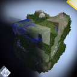

# Cubism

Cubism is a Minecraft mod that makes the overworld a finite cube planet in space.

Each of the six faces is a full Minecraft world. When you walk over an edge, gravity turns and you stand on the next face. Above the build height, you can float into space and see the whole planet. Overworld and Nether supported, End not yet supported.

[GOALS.md](GOALS.md) lists the features and the known limits.

## Requirements

- Minecraft 26.3
- Fabric Loader 0.20.1 or later
- Fabric API
- Java 25

To play, select the **Cubism** world type when you create a world. The mod must be on the server and on each client.

## Mod support

| Mod | Support | Notes |
|---|---|---|
| C2ME | 🟢 | |
| Continuity | 🟢 | Connected textures connect across the edges of the cube. |
| Distant Horizons | 🔴 | Not supported. Use Voxy. |
| Do a Barrel Roll | 🟢 | |
| Entity Culling | 🟡 | Entity Culling does not cull the entities of other faces. |
| Iris | 🟢 | Shader packs load. Only Complementary Unbound r5.9.3 follows the shape of the cube. |
| Lithium | 🟢 | Turns off a few options for collisions. |
| More Culling | 🟡 | |
| Sodium | 🟢 | |
| Voxy | 🟢 | |
| Voxygen | 🟢 | |
| Xaero's Minimap and Xaero's World Map | 🟡 | The maps show the six faces side by side, not as a cube. Waypoint markers and teleports work across faces. |

If you find a problem with another mod, open an issue. See [CONTRIBUTING.md](CONTRIBUTING.md).

## Client options

The client options are in `config/cubism-client.properties`. The game writes this file at the first start.

| Key | Default | Effect |
|---|---|---|
| `debugCommands` | `false` | Adds the `/cubelight` and `/cubevoxy` commands. For debugging. |
| `edgeCameraTilt` | `true` | The camera turns with gravity over an edge. When false, the camera turns only over the last 2 blocks before the seam. You can also set this in the Accessibility options. |
| `showStorageLine` | `false` | F3 shows the storage position and the chunks that are missing near you. For debugging. |
| `traceLoads` | `false` | Each world load writes a timeline to `logs/cubism-load-<time>.log`. For debugging. |
| `traceLook` | `false` | The look and the face of the player go to `logs/cubism-look.log`. For debugging. |

To write the load timeline on a dedicated server, start the server with `-Dcubism.loadTrace=true`.

## Build

1. Install Java 25.
2. Clone this repository.
3. Run `./gradlew build`.

The mod jar is in `build/libs`.

To copy each build into the mods folder of a test instance, add this line to `~/.gradle/gradle.properties`:

```properties
cubism.deployDir=/path/to/instance/mods
```

## License

MIT. See [LICENSE](LICENSE).
